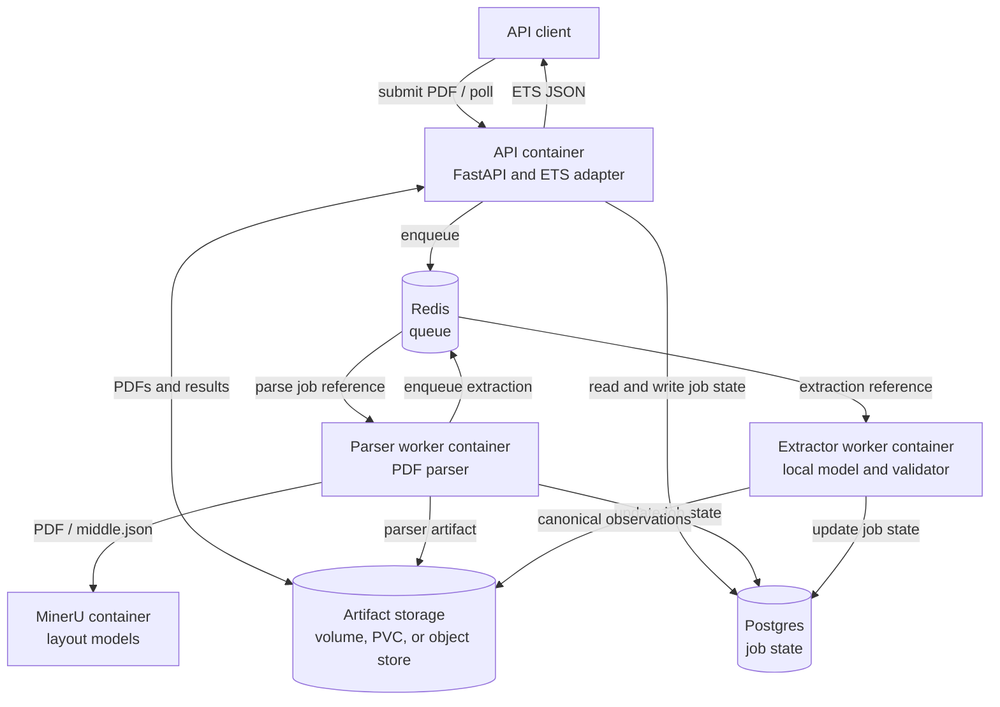
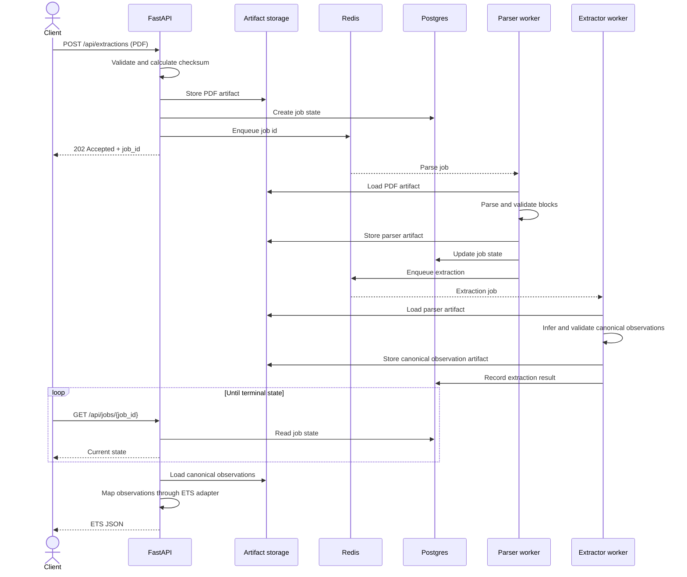
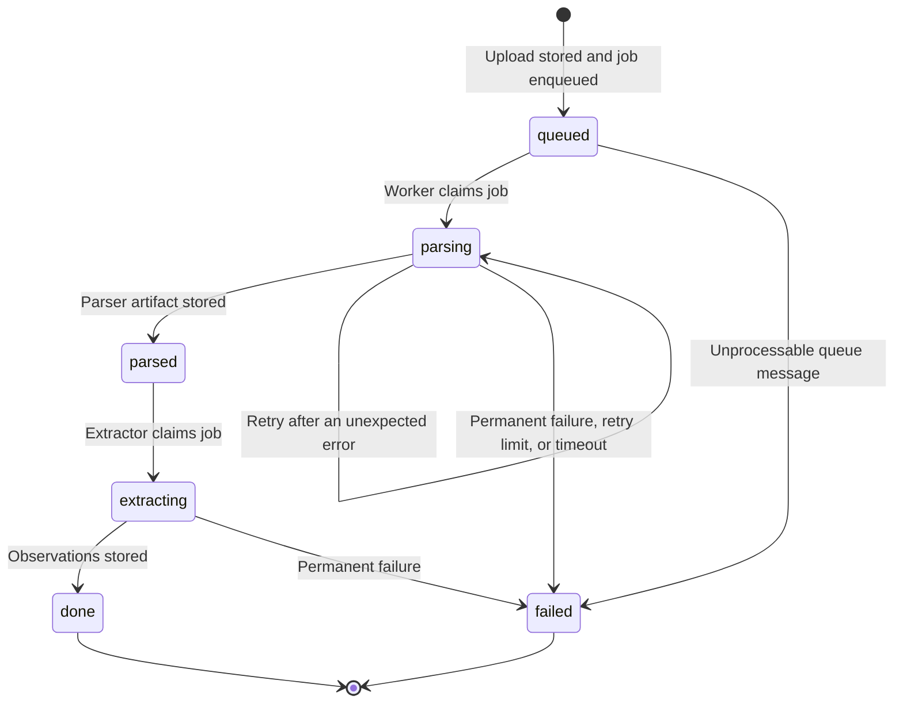
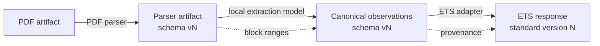

# BioParser architecture

## Purpose and scope

BioParser is a locally hosted service for extracting mammal traits from scientific
articles. Clients submit a digital born PDF and poll an asynchronous job. The article
is parsed into traceable content blocks, a local model extracts canonical observations,
and the API maps validated observations to Ecological Trait Data Standard (ETS) output.

The system must:

- run without external AI services
- keep every extracted observation traceable to its source
- avoid transporting large files through the job queue
- keep parsing, model inference, and ETS conversion independently replaceable
- run locally with Docker Compose and on OpenShift.

Scanned PDFs and OCR are not part of the initial proof of concept.

## System overview

Redis is the job queue. Queue messages carry only a job ID and a schema version.
Postgres holds one `jobs` row per job, including that job's artifact paths
(`pdf_ref`, `parse_result_ref`, `extract_result_ref`). The API and both workers
read and write those rows. Neither Redis nor Postgres holds PDF bytes or model
results; those stay in artifact storage.

Compose gives the API and both workers `BIOPARSER_DATABASE_URL`. A one-shot
`migrate` container uses the API image to create the `jobs` table, then exits.
The API and the workers start after that exit and do not migrate themselves.

## Components

### API

FastAPI owns the public HTTP contract:

- `POST /api/extractions` for PDF submission
- `GET /api/jobs/{job_id}` for job status and results
- `/health` for process liveness
- `/ready` a readiness endpoint for Redis and artifact storage availability

It validates and stores uploads before enqueueing work. Parsing and inference never run
in the request process. A separate, versioned API module maps canonical observations to
ETS deterministically.

### Queue and storage

Redis carries job references, retries, and timeouts. It is not an artifact
archive. PDFs and versioned outputs live behind an artifact storage interface:

- a named volume in Docker Compose
- a shared persistent volume on OpenShift
- an S3 compatible backend such as MinIO if shared storage is unavailable

### Job state

- **Table:** `jobs`, one row per `job_id`. The `Job` class in `bioparser.db.jobs`
  is that table. The API and both workers query it, and Alembic diffs the class
  when generating a revision.
- **Writes:** a claim, a recorded result, and a failure are each one statement.
  The statement changes its own columns and matches only a status that may make
  that change. No matching row leaves the job as it is. `created_at` and
  `updated_at` are set by the database. The update trigger sets `updated_at`.
- **Retention:** a row stays until something deletes it.
- **Timeouts:** a driver failure, including one raised by a statement inside
  the transaction, reports `DatabaseError`. The message names the driver error
  type and not the URL.

### Workers

The CPU oriented parser worker reads a PDF artifact, invokes the selected parser, stores
a validated parser artifact, and updates job state. It has no dependency on ETS or the
language model. The `mineru` backend sends the PDF to a separate MinerU service, which
holds the layout models and is the only parser part that needs a GPU.

The independently deployable extractor worker consumes parser artifacts, runs the local
model, and stores the result. An extractor returns the whole extraction artifact. An
extractor drops what it cannot ground. Before storing, the worker checks the artifact against its
schema, checks that it names the extractor and version the job runs, and checks every
range against the slice it names. A failure fails the job. The worker does not drop or
repair a field. It may have separate memory and GPU
requirements.
Initial milestones define this boundary and evaluate runtimes; production inference
comes later.

Health and readiness for workers

- Liveness (/health): a lightweight process liveness probe that returns success when the
  worker process is running.
- Readiness (/ready): a dependency-aware probe. When configured via environment variables
  (for example `BIOPARSER_REDIS_URL`, `BIOPARSER_ARTIFACT_STORAGE_PATH`) the worker's
  readiness endpoint checks the same minimal set of dependencies as the API:
  TCP-connect to Redis and a writable artifact storage path. Readiness checks are
  bounded by `BIOPARSER_DEPENDENCY_CHECK_TIMEOUT_SECONDS` and do not attempt
  authentication or expose secrets.

## Processing sequence

The parser-only path terminates successfully after storing the parser artifact.
The extractor and ETS steps are added without changing PDF submission or job polling.

## Job lifecycle

Workers tolerate duplicate delivery without corrupting completed jobs. Retries and
timeouts are bounded, and API errors do not expose secrets or stack traces.

## Data contracts and provenance

All stored structured artifacts have an explicit schema version. Artifacts are identified
and transferred across workers using typed references and metadata rather than transport paths.

### Artifact metadata and contracts

Artifacts across the pipeline (raw PDF uploads, parser outputs, and extractor observations)
are addressed by stable artifact paths using typed Pydantic models:

- `ArtifactMetadata` (`schema_version = "1"`): stores artifact identity and provenance:
  - `artifact_path`: the artifact's key. See [Artifact paths](#artifact-paths).
  - `media_type`: MIME media type (`application/pdf`, `application/json`, etc.).
  - `creation_info`: timestamp (`created_at` in UTC) and creator identifier (`created_by`).
  - `content_schema_version`: explicit schema version of structured content where applicable
    (e.g., `"1"` for parser artifacts; omitted for raw PDFs).
  - `size_bytes`: payload size in bytes.
- `StoredArtifact`: composite container bundling raw `content` (`bytes`) and `metadata` (`ArtifactMetadata`).

Queue messages carry no artifact paths. Workers read them from the job state record.

### Artifact paths

An artifact path is the key an artifact is stored under. It is deterministic: the storing
component (API or worker) builds it from the content checksum and the pipeline
configuration, so the same input always gives the same path and a stored artifact can be
reused.

Rules (`validate_artifact_path` in `bioparser.storage.artifact_paths`):

- Segments are separated by a single `/`. No empty segments, and no leading or trailing `/`.
- No `.` or `..` segments.
- Each segment is at most 200 characters of `A-Z a-z 0-9 _ . -`.
- The whole path is at most 512 characters.

Storage and job state both validate paths with these rules. Storage raises
`StoragePathTraversalError` for a `.` or `..` segment and `InvalidArtifactPathError` for
any other violation.

Convention:

| Artifact | Path | Builder |
|---|---|---|
| Uploaded PDF | `pdf/<pdf-checksum>` | `pdf_path(checksum)` |
| Parser artifact | `pdf/<pdf-checksum>/parsed/<backend>/<version>` | `parse_result_path(checksum, backend, version)` |
| Parser artifact of a configured backend | `pdf/<pdf-checksum>/parsed/<backend>/<version>/<configuration>` | `parse_result_path(checksum, backend, version, configuration)` |
| Extraction artifact | `<parse-result-path>/extracted/<extractor>/<extractor-version>` | `extract_result_path(parse_result_ref, extractor, extractor_version)` |

- `<pdf-checksum>` is the sha256 of the PDF bytes, from `bioparser.hashing`.
- `<backend>` is the parser backend name and `<version>` its version from
  `bioparser.parser_names.PARSER_VERSIONS`. Bumping a backend's version gives new results
  a new path, so results from the old version are not reused.
- `<configuration>` is the backend setting that also changes the output, as one readable
  segment. Today only MinerU has one: its tier (`basic`, `standard`, …), so a MinerU result is
  stored at `pdf/<pdf-checksum>/parsed/mineru/2/standard`. A different tier never reuses
  another tier's result. The configuration is not part of the version.
- The extraction path starts from the job's `parse_result_ref`, so it keeps every segment
  of that parse, including a MinerU tier. The extractor worker runs the extractor named
  on the job and takes its version from `bioparser.extractor_names.EXTRACTOR_VERSIONS` when
  the extraction runs. The job does not store that version. New jobs name the extractor
  `default`, whose version is `1`. Bumping it gives new results a new path, so
  results from the old version are not reused. The builders live in `bioparser.storage.artifact_paths`.
- Build paths with the builders, never by string formatting. Each builder argument must be
  a single valid segment, so a value like `a/b` cannot change the shape of the path.

Job state holds artifact paths, typed `ArtifactPath`:

| Field | Type | Set |
|---|---|---|
| `pdf_ref` | `ArtifactPath` | Always. The uploaded PDF, set when the job is created. |
| `parse_result_ref` | `ArtifactPath \| None` | In `parsed`, `extracting` and `done`. `None` in `queued`, `parsing` and `failed`. |

Queue messages carry only `job_id`. Workers read the paths from job state.

### Artifact storage interface

The `ArtifactStorage` protocol abstracts storage operations so components remain completely
independent of local paths or cloud storage SDKs:

- `store(content, metadata) -> str`
- `retrieve(artifact_path) -> bytes`
- `retrieve_metadata(artifact_path) -> ArtifactMetadata`
- `retrieve_artifact(artifact_path) -> StoredArtifact`
- `exists(artifact_path) -> bool`

The `FileSystemArtifactStorage` implementation stores artifacts inside a configurable root
directory using an atomic layout (`{artifact_path}.{blob_id}.data` and `{artifact_path}.meta.json`).
Payloads are written as immutable blobs first, followed by an atomic link (on creation)
of the metadata JSON file as the single commit point. If the artifact already exists, an error is natively raised. This guarantees that simultaneous writes cannot interleave
or mismatch payload and metadata, eliminates fragile lock files, and allows readers to safely resolve the exact
committed blob. Corrupted metadata or mismatched content sizes are detected and raised as `StoragePayloadError`.
Artifact paths are strictly validated using an allowlist regex and verified
via `is_relative_to` to prevent path traversal outside the storage root. Future S3-compatible backends implement
the same interface without changing pipeline contracts.

### Parser artifact

A parser artifact contains the checksum, parser and schema versions,
and ordered content blocks. Each block has a stable ID, type, page number, text, and
source coordinates.

### Canonical extraction artifact

A finished extraction stores one observation per measurement. Each paper field keeps the printed text and a character range in a parser block. A field that cannot be located is not stored, and an observation missing a required field is dropped by its extractor.

The stored file checks its shape: the trait code, a required string, and that a range is ordered. The worker checks every range against the slice it names before storing, for any extractor. A mismatch fails the job. An unresolved name and a unit that cannot be converted are stored as printed. The file does not decide whether a measurement is good enough to show.

The ETS adapter is the quality gate for what a user is shown. It resolves the name, converts the unit, and decides whether a weak field becomes a warning, an empty id, or a dropped row. An extractor may call those same checks while it is still working, and drop or repair a field before storing it. It does not have to. The stored file can hold a value the response rejects, such as a unit that does not fit the trait.

The field list and the evidence rules are in [extraction-artifact.md](extraction-artifact.md). What the ETS adapter derives is in [ets-adapter.md](ets-adapter.md).

## Deployment

### Docker Compose

Docker Compose runs FastAPI, Redis, the parser worker, the extractor worker, and
shared artifact storage. Services use versioned images and environment configuration.
Model weights come from local infrastructure. Workers do not download from external AI
services at runtime.

### OpenShift

The API and workers are separate OpenShift workloads with independent scaling and
resource limits. Only workers that need a GPU are scheduled onto GPU nodes.
Configuration covers Redis, storage claims, secrets, liveness, and readiness. Shared
artifacts never rely on pod local storage.

## Cross cutting requirements

- Logs include relevant job, document, artifact, parser, model, and schema identifiers.
- File size, page count, processing time, and retry limits protect the service.
- Uploaded filenames are metadata only and are never used directly as storage paths.
- Configuration and errors do not expose secrets.
- Tests can replace the queue, job queries, and storage with in-memory stand-ins.
- Integration tests cover the real Redis queue, Postgres job rows, and shared storage path.
- Production requires an artifact retention and deletion policy.

## Evolution points

Without changing the public job workflow, the system can replace parsers, storage, or
model runtimes. It can add OCR and table extraction, support domains such as diet, and
add new ETS versions or other output adapters.
